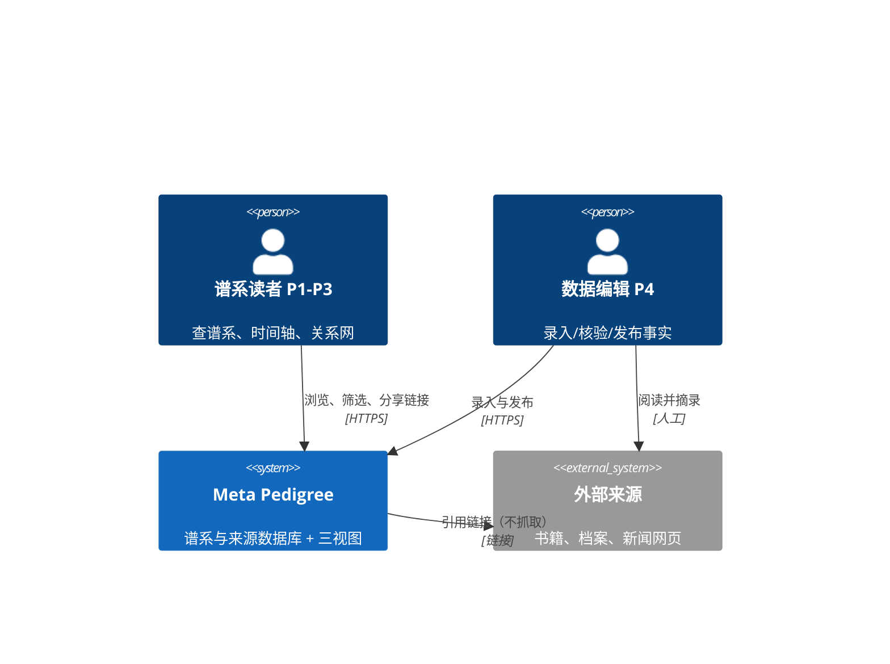

# Architecture
Audience: engineers · Last updated: 2026-11-14 by UGcraftist
Sources: DR-0005 (Supabase + Cloudflare; supersedes DR-0002/DR-0004 runtime+deploy), DR-0003 (data model), requirements.md (NFR-001…), ux.md

## Shape

**无应用服务器（DR-0005）**：静态 SPA（Cloudflare Pages）直接调 Supabase（PostgREST + Auth + RLS）。

```
浏览器 SPA ──HTTPS──> Cloudflare Pages（静态托管）
     │
     └──HTTPS + JWT──> Supabase: PostgREST ──> PostgreSQL 16
                        Auth（邀请制）
                        RLS（R1 关闭 anon 读；R2 打开 published 只读）
```

R1 无后台任务、无缓存层、无自建进程；业务校验在 SQL 函数/触发器里（`submit_fact` 等 RPC），
展示逻辑（树布局、时间轴刻度、SVG）在客户端。PNG 导出在前端完成，不经过服务器。

## Context



## Containers

```mermaid
C4Container
  Container(web, "web", "React 19 + Vite + TS on Cloudflare Pages", "三视图、详情、录入台；D3/SVG")
  Container(pgr, "Supabase PostgREST", "托管 API", "读=视图，写=RPC 函数")
  ContainerDb(pg, "PostgreSQL 16 (Supabase)", "单库", "org/person/fact/source + 注册表")
  Container(auth, "Supabase Auth", "托管鉴权", "邮箱+密码，JWT 角色");

  Rel(web, pgr, "JSON over HTTPS + JWT")
  Rel(pgr, pg, "SQL + 递归 CTE")
  Rel(web, auth, "登录/刷新 token", "HTTPS")
```

| Container | 职责 | 关键约束 |
|---|---|---|
| `web/` | S-01…S-10；URL 状态；SVG 导出 PNG；布局与交互逻辑 | NFR-001（首屏 ≤3s）、NFR-004（放大不重叠）、NFR-002（无硬编码颜色） |
| Supabase PostgREST | 读=视图（`tree_nodes`/`timeline_events`/…），写=RPC（`submit_fact`/`upsert_stance`/`merge_source`）+ RLS | NFR-003（≤200ms/事实）；RLS 是唯一防线（DR-0005） |
| PostgreSQL | 唯一事实源；递归 CTE 出树；约束+触发器承担校验 | 迁移只向前（DR-0003） |
| 契约 `openapi.yaml` | PostgREST/RPC 面的词表与类型单一来源（非容器） | web 由它生成类型（T-004） |

## 关键流程

- 树：`POST /api/v1/tree` 语义不变，落成 PostgREST 视图 `tree_nodes`/`tree_edges`（递归 CTE，`relation_type.implied_parent` 决定方向）→ 前端 D3 布局（US-004）。
- 冲突并列：一个 (subject,predicate,object) 多行 → API 分组返回 → S-08 并列显示，可分别引用（US-009）。
- 无来源：fact 无 source 行 → API 返回 `has_source:false` → S-07 画虚线 + `无来源` 标签（FR-001）。
- 发布：RPC `submit_fact` 单事务完成"校验（来源或显式无来源 + 时间精度非空）→ 关旧修订 → 插新修订 → 写 audit_log"（TH-02）。

## NFR 追溯

| NFR | 设计回应 |
|---|---|
| NFR-001 首屏 ≤3s | 单页 + 树一次性取 ≤100 组织；SVG 布局在客户端；无外部字体阻塞 |
| NFR-002 无硬编码颜色 | D1 token 在 `tokens.css`，组件只引用变量 |
| NFR-003 点开事实 ≤200ms | 详情接口单查询带 sources；索引在 data-model.md |
| NFR-004 字放大不重叠 | 字体相对单位 + 树节点最小间距可配；ux.md 验收 |
| 审计 | fact 修订链 + audit_log 行（编辑者、时间、摘要） |

## 部署（R1）

| 环境 | 前端 | 数据/API | 说明 |
|---|---|---|---|
| 本地 | `npm run dev`（Vite，127.0.0.1:5173） | Supabase 云 **dev** 项目（本机无 Docker，不用 `supabase start`） | `.env.local`：`VITE_SUPABASE_URL` + `VITE_SUPABASE_ANON_KEY` |
| 分支预览 | Cloudflare Pages 每个分支自动预览 URL | 同上，**dev** 项目 | Pages 的 Preview 环境变量指向 dev |
| 生产 | Cloudflare Pages`meta-pedigree`（Production） | Supabase **prod** 项目 | Pages Production 环境变量指向 prod；自定义域名待定 |

**Supabase 项目命名与创建时机**

- 组织 `meta-pedigree`，项目名用连字符：`meta-pedigree-dev`、`meta-pedigree-prod`（Supabase 项目名按 slug 处理，下划线不稳妥；仓库名 `meta-pedigree` 保持一致）。
- **现在只建 dev**；`meta-pedigree-prod` 在 stage 7 发布时创建（12-13 之前不建）：避免误写生产、避免免费层闲置项目自动暂停，schema 全部由 `supabase/migrations` 重放，建库时间可预期。
- 区域：`ap-northeast-1`（东京）或就近区域；创建后不可改，只能迁移。
- 免费层每组织 2 个项目、无活跃自动暂停——dev 暂停可恢复，不影响数据。
- 密钥只存本地 `.env`/`.env.local`（gitignore），Pages 环境变量在 Cloudflare 控制台设置；仓库里只有 `.env.example` 占位。
