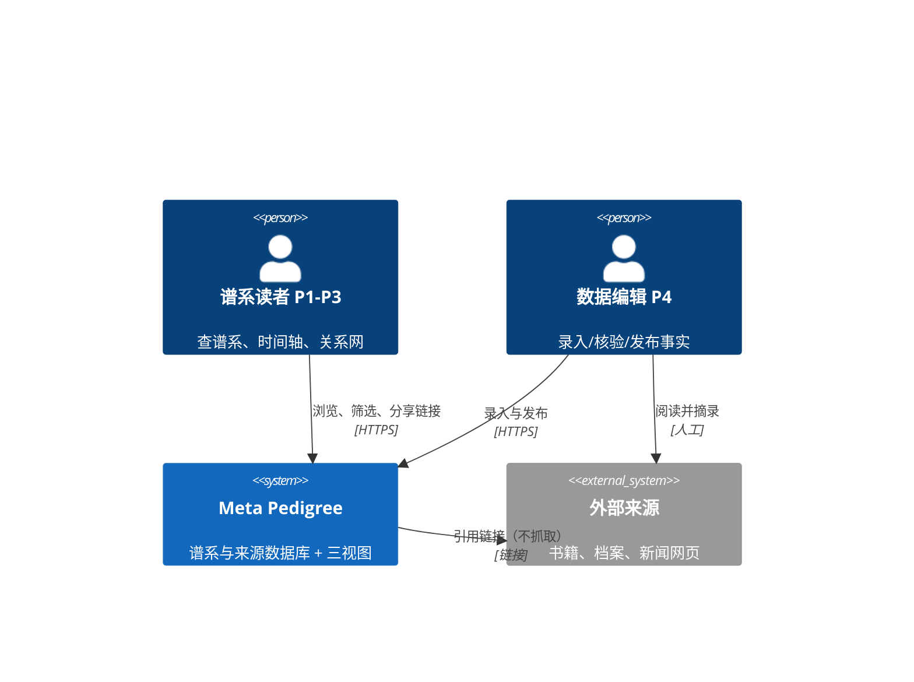
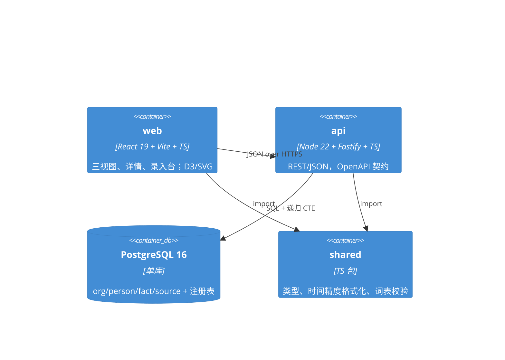

# Architecture
Audience: engineers · Last updated: 2026-11-14 by UGcraftist
Sources: DR-0002 (stack), DR-0003 (data model), requirements.md (NFR-001…), ux.md

## Shape

模块化单体（DR-0002）：一个 API 进程 + 一个 SPA，一个 PostgreSQL。R1 无第三方服务，
无后台任务，无缓存层。所有读操作走 API；PNG 导出在前端 SVG 上完成，不经过服务器。

## Context

## Containers

| Container | 职责 | 关键约束 |
|---|---|---|
| `apps/web` | S-01…S-10；URL 状态；SVG 导出 PNG | NFR-001（首屏 ≤3s）、NFR-004（放大不重叠）、NFR-002（无硬编码颜色） |
| `apps/api` | 读 API + 编辑 API；发布校验（来源/时间精度）；审计写入 | NFR-003（≤200ms/事实）；服务端鉴权 |
| PostgreSQL | 唯一事实源；递归 CTE 出树 | 迁移只向前（DR-0003） |
| `packages/shared` | 词表与类型单一来源 | 前端/后端不得各自定义时间精度文案 |

## 关键流程

- 树：`GET /api/v1/tree` → 递归 CTE（relation_type.implied_parent 决定父子方向）→ 前端 D3 布局（US-004）。
- 冲突并列：一个 (subject,predicate,object) 多行 → API 分组返回 → S-08 并列显示，可分别引用（US-009）。
- 无来源：fact 无 source 行 → API 返回 `has_source:false` → S-07 画虚线 + `无来源` 标签（FR-001）。
- 发布：S-10 保存 draft → 提交 in_review → 发布校验（来源或显式无来源 + 时间精度非空）→ published，写审计行。

## NFR 追溯

| NFR | 设计回应 |
|---|---|
| NFR-001 首屏 ≤3s | 单页 + 树一次性取 ≤100 组织；SVG 布局在客户端；无外部字体阻塞 |
| NFR-002 无硬编码颜色 | D1 token 在 `tokens.css`，组件只引用变量 |
| NFR-003 点开事实 ≤200ms | 详情接口单查询带 sources；索引在 data-model.md |
| NFR-004 字放大不重叠 | 字体相对单位 + 树节点最小间距可配；ux.md 验收 |
| 审计 | fact 修订链 + audit_log 行（编辑者、时间、摘要） |

## 部署（R1）

本地：`docker compose up db` + `pnpm dev`（api 与 web）。生产部署决策推迟到 stage 7（DR-0002）。
