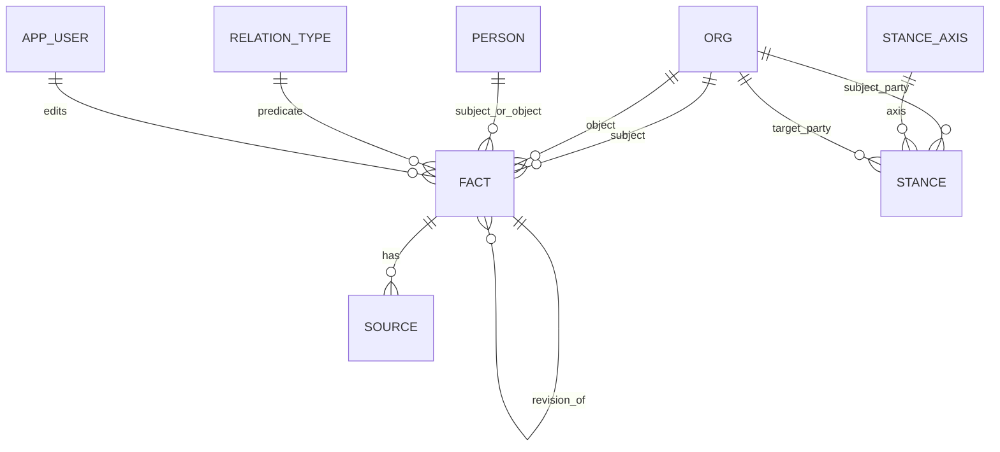
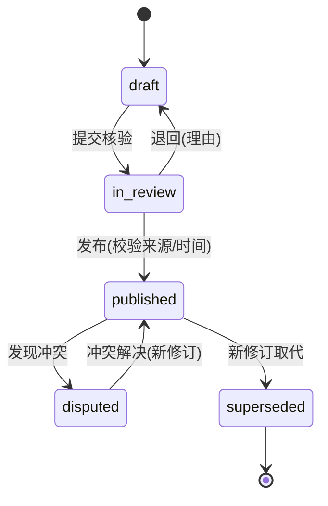

# Data model
Audience: engineers · Last updated: 2026-11-15 by UGcraftist
Sources: DR-0003 (schema), DR-0002 (storage), requirements.md FR-001…FR-024

## Stores

| Store | Holds | Source of truth? | Decision record |
|---|---|---|---|
| PostgreSQL 16 | org, person, fact, source, relation_type, stance_axis, stance, audit_log, app_user | yes | DR-0002, DR-0003 |
| 无对象存储（R1） | — | — | 图片/附件留 R2 |

SQL 表名用复数（PostgREST 约定）：`orgs`、`persons`、`facts`、`sources`、`fact_sources`、
`relation_types`、`stance_axes`、`stances`、`audit_log`、`app_users`。下文实体名用单数。

## Entities

| Entity | Key fields | Owner module | Sensitivity | Retention | FRs |
|---|---|---|---|---|---|
| org | id uuid v7, name, kind, country_code, founded_*, dissolved_*, visibility | api/orgs | public (hidden 例外) | 永久 | FR-002, FR-011, FR-012 |
| person | id uuid v7, name, aliases[], birth_*, death_* | api/persons | public | 永久 | FR-002 |
| relation_type | code, label_zh/en, subject_kinds[], object_kinds[], implied_parent, attrs_schema | api/registry | public | 永久 | FR-015, US-024 |
| fact | id, subject_*, predicate_code, object_*, period_*, amount, attrs, certainty, status, visibility, revision_of, no_source | RPC (T-007) | public/hidden | 永久（修订链保留） | FR-013…FR-016 |
| source | id, fact_id, kind, title, author, url, page, quote, accessed_at | api/facts | public | 永久 | FR-017…FR-019 |
| stance_axis | code, label, scale_min/max, anchors | api/registry | public | 永久 | FR-016, US-024 |
| stance | id, party_org_id, axis_code, value, target_*, period_*, status | api/stances | public/hidden | 永久 | US-024 |
| audit_log | id, actor_id, entity, entity_id, action, summary, at | api/audit | private | 2 年 | US-021, NFR |
| app_user | id (= auth.users.id), email, display_name；**role 在 Auth JWT `app_metadata.role`**（DR-0005），表里不重复存 | Supabase Auth | private | 在职期间 | security.md |

关系类型的两端是注册表数据（US-024），`0006` 的写路径执行这条合同：

- `subject_kinds` 为空 = **任意主体种类**；非空 = 主体种类必须在列内。
- `object_kinds` 为空 = **该关系不允许 object**（`founded` 这类单端事实）；非空 = **必须带 object**，且种类在列内。

改谓词只改注册表行，不改代码（FR-009）；新增谓词时按上面的语义填数组。

## ER

## Temporal columns (FR-014)

`start_date`, `start_precision` ∈ {day,month,year,unknown}, `end_date`, `end_precision`,
`qualifier` ∈ {exact,circa,before,after,between,unknown}。展示文案由 `web/` 的格式化模块统一生成（DR-0004）；后端只出结构化日期 + precision，不出文案。
CHECK：precision=unknown ⇒ date IS NULL；precision=year ⇒ date = date_trunc('year', date)。

## 立场轴（政党槽位）

| axis_code | label | 范围 | 锚点 |
|---|---|---|---|
| left_right | 左右 | -2..+2 | 极左…极右 |
| china | 对华态度 | -2..+2 | 敌对 -2，中立 0，友好 +2 |
| us | 对美态度 | -2..+2 | 敌对 -2，中立 0，友好 +2 |

新增轴 = 插 `stance_axis` 行（US-024），不需迁移。企业数据集的行数为 0。

## Lifecycles

## Indexes

- fact(subject_id, predicate_code), fact(object_id), fact(status) partial where status='published'
- org(visibility, kind), source(fact_id), stance(party_org_id, axis_code)
- 树查询：fact(subject_id) include when relation_type.implied_parent and status='published'
- implied_parent 极性：`split_from` / `controlled_by` / `merged_into` 的 **object 是父**（subject 是子）；其余隐含父关系的 **subject 是父**。`tree_edges` 视图统一归一化为 parent→child（0003 修正）。

## Migrations

`supabase/migrations/NNNN_*.sql`，只向前。应用方式：在 Supabase SQL 编辑器粘贴执行，并保存为命名查询
`meta-pedigree-dev:000N_<name>`；prod 在发布时按序重放。不使用 `DATABASE_URL`、`psql` 或
`supabase db push`（[DR-0006](../decisions/0006-migrations-via-sql-editor-service-role-only.md)）。种子数据由
`seed/importer.py` 校验后经 PostgREST + service_role 导入，校验规则与本节 CHECK 一一对应
（`make seed-dry` 不需要网络）。

计划内的迁移（R1 → M2）。每行都要能回答"这个对象凭什么在库里"：

| 迁移 | 任务 | 内容 | 改表？ | 路由 | dev 回执 | prod | 权限变化 |
|---|---|---|---|---|---|---|---|
| `0001_init` | T-002 | 10 张表 + 枚举 + RLS + 审计触发器 | 建表（已应用 2026-11-15） | SQL editor | `meta-pedigree-dev:0001_init` | — | `revoke all` 全部表 from anon/authenticated；select 给 authenticated |
| `0002_read_model` | T-004 | `tree_nodes`/`tree_edges`/`org_detail` 视图（PostgREST 不能执行递归 CTE） | 否，新增视图（已应用 2026-11-15） | SQL editor | `meta-pedigree-dev:0002_read_model` | — | 新建视图触发 Supabase default privileges：anon/authenticated 各得 ALL（未预期，0005 收紧） |
| `0003_tree_direction` | T-004 | `split_from`/`controlled_by`/`merged_into` 的父子极性归一 | 否，视图重定义（已应用 2026-11-15） | SQL editor | `meta-pedigree-dev:0003_tree_direction` | — | drop/create 视图 → default privileges 再次给 anon/authenticated ALL；文件自身无 grant |
| `0004_tree_nodes_dedup` | T-004 | 每个组织一行（min-depth 去重）+ 恢复 grants | 否，视图重定义（已应用 2026-11-15） | SQL editor | `meta-pedigree-dev:0004_tree_nodes_dedup` | — | `grant select on tree_nodes to authenticated`（只补了 tree_nodes） |
| `0005_org_detail_subject` | T-006 fix | `org_detail` 增 subject 侧（按可见性过滤），供抽屉渲染完整三元组 | 否，视图重定义（已应用 2026-11-19） | SQL editor | `meta-pedigree-dev:0005_org_detail_subject`（已贴） | — | `revoke all` 三个视图 from anon；authenticated 改为 SELECT-only；`views-probe` 三视图 anon 均 401 |
| `0006_write_rpc` | T-007 | `normalize_url`、`ensure_app_user`（补 app_users 行，jwt email 入审计）、`upsert_fact`（内嵌 sources[] 同事务；校验注册表 is_active + subject/object kind 兼容；悬空 id 命名）、`submit_fact`（源或显式无源、旧修订 superseded、审计 old→new + actor id/email）、`upsert_stance`、`merge_source`（归一化 URL 相等才合并） | 否，新增函数（已应用 2026-11-19） | SQL editor | `meta-pedigree-dev:0006_write_rpc`（已贴） | — | 除 `normalize_url`（immutable，仅 pinned `search_path`、无 EXECUTE 授权）外每个函数 `security definer` + `set search_path`；`revoke execute from public, anon`（helper 连 authenticated 也不给）+ 写 RPC `grant execute to authenticated`；无表级写策略 |
| `0007_search` | T-013 | `pg_trgm` + `search_orgs` + 检索索引 | 否，新增函数/索引（计划） | SQL editor | 待贴 | — | 同上（函数 execute 默认对 PUBLIC） |
| `0008_detail_contract` | T-010 | `facts_for(uuid)`（一次成型的 fact JSON：status、conflict_key、两端可见性门禁、来源 author/page/published_at/accessed_at/locator）+ `org_detail` 改为调用它；同时收 `disputed` | 否，新增函数 + 视图重定义（待贴） | SQL editor | 待贴（CR-010 后） | — | drop/create 视图与函数授权：revoke anon、authenticated SELECT-only；函数 execute 只给 authenticated/service_role；`views-probe` 继续断言 anon 401 |

**2026-11-15 漂移核查（CR-006）**：`role_table_grants` 显示 `anon` 对三个视图都有 SELECT 及写权限、
`authenticated` 对视图是 ALL——来源是 Supabase default privileges（`public` 新建对象默认全授权），
不是手工 grant。`0005` 用显式 `revoke` 收紧并把规则写进文件。**不变式：库里每个对象和每条授权，
都必须能在某个迁移文件里找到；`grant/revoke` 属于迁移内容，不是附注。**

**迁移编号只在本台账分配**；其他文档按名字引用（`write_rpc`、`search`），不写数字。
复核触发条件以 DR-0006 §Revisit triggers 为准；本文件不复述。

## Keys

主键默认 `public.uuidv7()`（48-bit 毫秒 + 随机尾，版本 7）：种子导入、RPC、视图都按创建时间可排序，
keyset 分页不需要额外索引。PostgreSQL 16 没有内置 `uuidv7()`，函数在 `0001_init.sql` 里定义并测试。
