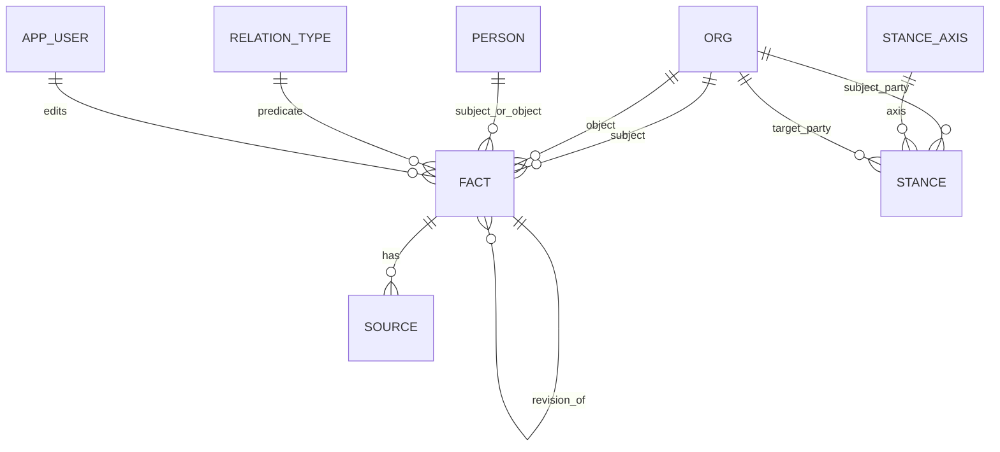
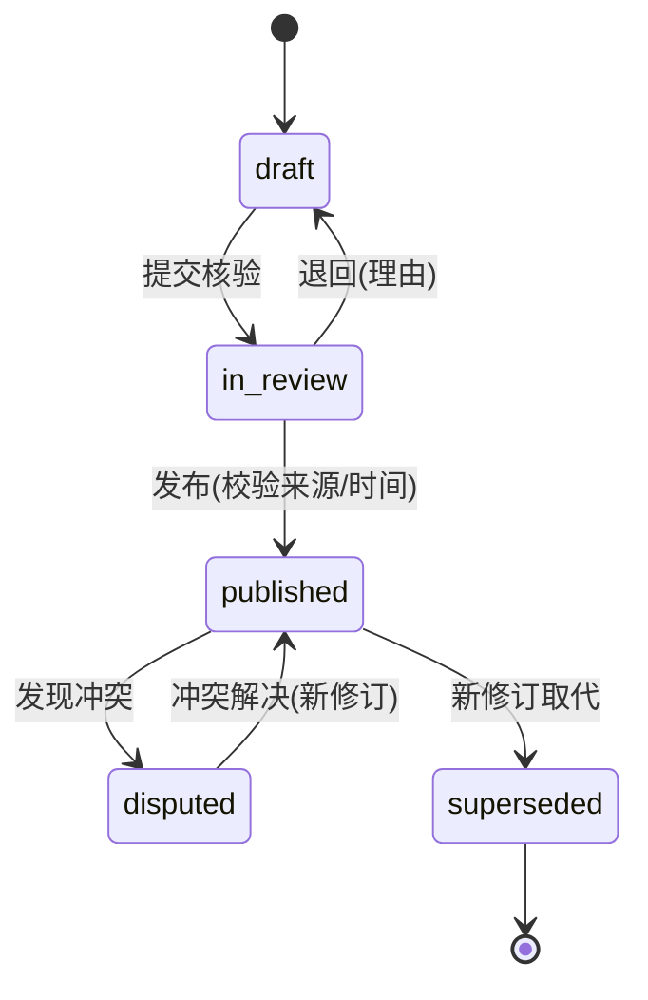

# Data model
Audience: engineers · Last updated: 2026-11-14 by UGcraftist
Sources: DR-0003 (schema), DR-0002 (storage), requirements.md FR-001…FR-024

## Stores

| Store | Holds | Source of truth? | Decision record |
|---|---|---|---|
| PostgreSQL 16 | org, person, fact, source, relation_type, stance_axis, stance, audit_log, app_user | yes | DR-0002, DR-0003 |
| 无对象存储（R1） | — | — | 图片/附件留 R2 |

SQL 表名用复数（PostgREST 约定）：`orgs`、`persons`、`facts`、`sources`、`fact_sources`、
`relation_types`、`stance_axes`、`stances`、`audit_log`、`app_users`。下文实体名用单数。

## Entities

| Entity | Key fields | Owner module | Sensitivity | Retention | FRs |
|---|---|---|---|---|---|
| org | id uuid v7, name, kind, country_code, founded_*, dissolved_*, visibility | api/orgs | public (hidden 例外) | 永久 | FR-002, FR-011, FR-012 |
| person | id uuid v7, name, aliases[], birth_*, death_* | api/persons | public | 永久 | FR-002 |
| relation_type | code, label_zh/en, subject_kinds[], object_kinds[], implied_parent, attrs_schema | api/registry | public | 永久 | FR-015, US-024 |
| fact | id, subject_*, predicate_code, object_*, period_*, amount, attrs, certainty, status, visibility, revision_of, no_source | RPC (T-007) | public/hidden | 永久（修订链保留） | FR-013…FR-016 |
| source | id, fact_id, kind, title, author, url, page, quote, accessed_at | api/facts | public | 永久 | FR-017…FR-019 |
| stance_axis | code, label, scale_min/max, anchors | api/registry | public | 永久 | FR-016, US-024 |
| stance | id, party_org_id, axis_code, value, target_*, period_*, status | api/stances | public/hidden | 永久 | US-024 |
| audit_log | id, actor_id, entity, entity_id, action, summary, at | api/audit | private | 2 年 | US-021, NFR |
| app_user | id (= auth.users.id), email, display_name；**role 在 Auth JWT `app_metadata.role`**（DR-0005），表里不重复存 | Supabase Auth | private | 在职期间 | security.md |

## ER

## Temporal columns (FR-014)

`start_date`, `start_precision` ∈ {day,month,year,unknown}, `end_date`, `end_precision`,
`qualifier` ∈ {exact,circa,before,after,between,unknown}。展示文案由 `web/` 的格式化模块统一生成（DR-0004）；后端只出结构化日期 + precision，不出文案。
CHECK：precision=unknown ⇒ date IS NULL；precision=year ⇒ date = date_trunc('year', date)。

## 立场轴（政党槽位）

| axis_code | label | 范围 | 锚点 |
|---|---|---|---|
| left_right | 左右 | -2..+2 | 极左…极右 |
| china | 对华态度 | -2..+2 | 敌对 -2，中立 0，友好 +2 |
| us | 对美态度 | -2..+2 | 敌对 -2，中立 0，友好 +2 |

新增轴 = 插 `stance_axis` 行（US-024），不需迁移。企业数据集的行数为 0。

## Lifecycles

## Indexes

- fact(subject_id, predicate_code), fact(object_id), fact(status) partial where status='published'
- org(visibility, kind), source(fact_id), stance(party_org_id, axis_code)
- 树查询：fact(subject_id) include when relation_type.implied_parent and status='published'

## Migrations

`supabase/migrations/NNNN_*.sql`，只向前；CI 在空库 + 上一版快照各跑一次（T-022）。本地/CI 用
`supabase db push` 或按文件名顺序 `psql -f`。种子数据由 `seed/importer.py` 校验后导入，校验规则
与本节 CHECK 一一对应（`make seed-dry` 不需要数据库）。

## Keys

主键默认 `public.uuidv7()`（48-bit 毫秒 + 随机尾，版本 7）：种子导入、RPC、视图都按创建时间可排序，
keyset 分页不需要额外索引。PostgreSQL 16 没有内置 `uuidv7()`，函数在 `0001_init.sql` 里定义并测试。
