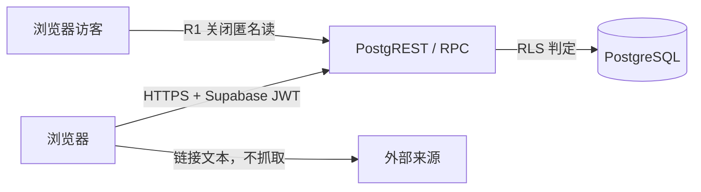

# Security
Audience: engineers, operator · Last updated: 2026-11-14 by UGcraftist
Sources: DR-0002, DR-0003, api.md, rules/security.md

R1 是单编辑器工具，部署在 Supabase + Cloudflare Pages（DR-0005）：无公开写入口、无用户上传。
安全边界由 **RLS + Auth JWT** 承担，而不是自建 API 的中间件；安全设计按"泄露会怎样"排序。

## Trust boundaries

- 边界 1：浏览器 ↔ PostgREST。所有授权在数据库里判定（RLS + `SECURITY DEFINER` RPC），
  前端隐藏按钮不构成控制；JWT 由 Supabase Auth 签名。
- 边界 2：PostgREST ↔ DB。应用角色只有 `authenticated`；写路径不开放表级 INSERT/UPDATE，
  只走校验过的 RPC（T-007）。`service_role` 仅本机种子导入与 `make probe` 使用。
  所有 `SECURITY DEFINER` 函数显式 `SET search_path = pg_catalog, public, pg_temp`，
  防止函数内对象解析被 schema 劫持（T-007 起对每个函数生效）。
- 边界 3：API ↔ 外部来源。R1 只存链接文本，**不抓取、不渲染远程 HTML**，故无 SSRF/远程执行面。

## STRIDE（R1）

| 威胁 | 场景 | 评级 | 处置 |
|---|---|---|---|
| Spoofing | 伪造编辑者身份写事实 | 中 | Supabase Auth（邮箱+密码，邀请制）+ JWT 里的 `app_metadata.role` + 审计行（actor_id）；R2 换 SSO（DR 待开） |
| Tampering | 直接改表绕过校验 | 低 | 表级写权限已收回，写只走 RPC；审计 append-only 触发器；迁移脚本评审 |
| Repudiation | 否认改过某条事实 | 中 | 修订链保留旧行 + audit_log |
| Information disclosure | 受限对象（hidden）被公开站索引 | 中 | visibility 在查询层过滤；R2 公开站只导出 public 快照 |
| DoS | 递归树查询拖垮 DB | 低 | depth ≤6、limit ≤200、语句超时 5s |
| Elevation of privilege | 访客调编辑接口 | 中 | 服务端逐路由校验 role=editor（不依赖前端） |

## Roles

R1 角色是 Supabase Auth 用户元数据：`app_metadata.role = 'editor'`。Anon 角色无任何数据权限
（R1 站点必须登录；R2 才为 published 事实打开 anon 只读）。

| Role | Capabilities | Holder |
|---|---|---|
| anon | 无（R1） | — |
| editor | 读种子/事实/审计；经 RPC 建、改、提交、发布 | UGcraftist |
| authenticated（非 editor） | 只读被 RLS 拦成 0 行；写 RPC 一律 42501 | 测试账号（Supabase Auth，R1 由 UGcraftist 建） |
| admin (Supabase owner) | 邀请用户、设 `app_metadata.role`、跑迁移 | UGcraftist（单一持有人 —— 见风险 R-001） |

gate 检查要求每个管理角色两名具名持有人；R1 只有一人，**记为已知例外**（UGcraftist 2026-11-14 接受）：R2 前补第二持有人
（或明确"单人运维"接受书）。

## Credentials

| Name | Used by | Owner | Stored where |
|---|---|---|---|
| `VITE_SUPABASE_ANON_KEY` | web | UGcraftist | `web/.env.local` / Pages 环境变量；**可公开**，安全靠 RLS |
| `SUPABASE_SERVICE_ROLE_KEY` | 种子导入、`make probe` | UGcraftist | 本机 `.env`；**绝不进前端、CI、仓库**；绕过 RLS 读写暴露表，但**不能 DDL、不触达 auth schema**；控制台可单独 rotate |
| `SUPABASE_EDITOR_EMAIL` / `SUPABASE_EDITOR_PASSWORD` | `make views-probe` / `make write-probe` 的 authenticated 读写 | UGcraftist | 本机 `.env`；账号在 Supabase Auth（`app_metadata.role='editor'`），密码不进仓库 |
| `SUPABASE_READONLY_EMAIL` / `SUPABASE_READONLY_PASSWORD` | `make write-probe` 的非 editor 拒写断言 | UGcraftist | 本机 `.env`；Supabase Auth 另建一个普通 authenticated 账号 |
| `GEMINI_API_KEY`（可选，仅设计稿） | 图像生成 | UGcraftist | 用户本机配置，不进仓库 |

迁移不经网络直连：`supabase/migrations/*.sql` 由人在控制台 SQL 编辑器粘贴（DR-0006），故无 `DATABASE_URL`。

## Rules

- 来源 URL 只允许 `http(s)`，存文本，点击时 `rel="noopener noreferrer"`，不嵌入 iframe。
- 所有输入按 UTF-8 文本转义；前端不用 `dangerouslySetInnerHTML`。
- 依赖锁定 + `pnpm audit` 进 CI；R1 不引入运行时远程脚本。
- 日志不写 token、不写完整 URL 查询串。
- `anon` 的表权限已整体收回，故 anon 请求直接 401/403；若未来只靠策略过滤，UPDATE/DELETE 会返回 **200 + 0 行**（不是报错），`make probe` 两种都按拒绝处理，防止把静默无操作误判为放行。RPC 探针同理：**403/42501 或 404 都算拒绝**（没有 EXECUTE 权限时 PostgREST 可能两者之一），且每次拒绝后都要断言相关表行数未变。

## Accepted risks

- R-001 单人持有全部凭据与知识 → 已记入 risks.md，接受直到 R2 扩员。
- 本地 R1 无 TLS（跑在 localhost）→ 不对外暴露；部署时强制 HTTPS（stage 7 检查项）。
