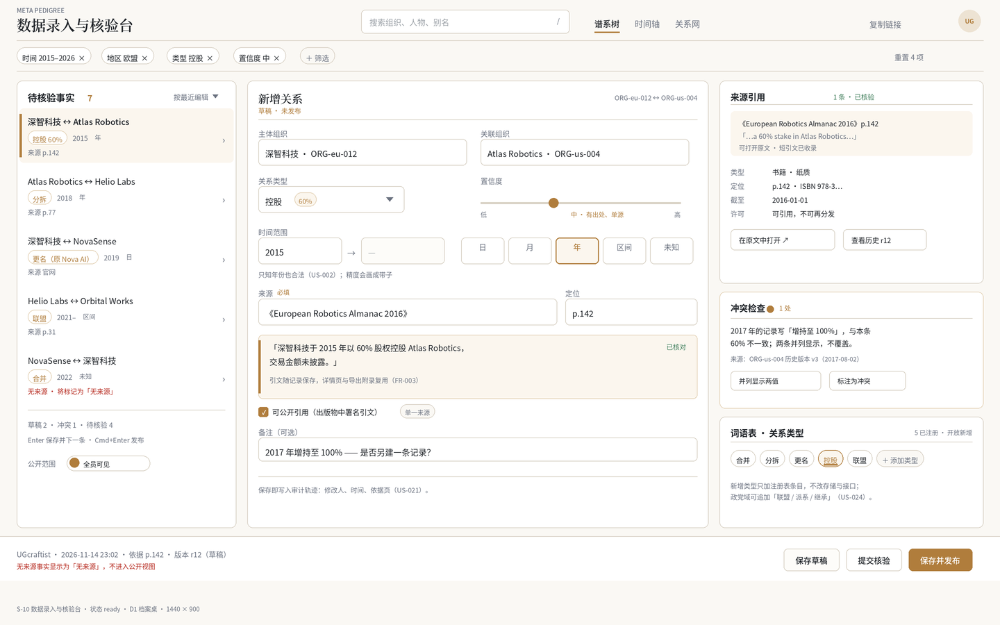

# UX
Audience: developers, product owner · Last updated: 2026-11-14 by UGcraftist
Sources: [product/stories.md](../product/stories.md), [product/requirements.md](../product/requirements.md), reference cases in `ref/` (Nepal History Network, 家族森林)

> Scope: Must screens are S-01 … S-10 and S-12; S-11 is R2. No Figma file exists yet
> (no Figma connection in this environment), so this page is the design source of truth until
> a file is created; frames must be built in the chosen direction before stage 3 hands over to code.

## Art direction

No brand assets exist. Three directions, each with a palette, type and references. A named person
picks one; the choice and its reason are recorded here.

### D1 档案桌 Archive desk (recommended for R1)
- Mood: **calm, precise, editorial**.
- Palette: paper `#FAF8F4`, ink `#1F2328`, rule `#D9D2C6`, brass accent `#B07D3C`, muted `#6B7280`,
  success `#3F7D5A`, warning `#B07D3C`, error `#B42318`. Contrast: ink on paper 14.6:1, muted on paper 4.9:1.
- Type: headings Noto Serif SC / Source Serif 4; body Noto Sans SC / Inter, 14/20 body, 1.25 scale.
- References: CBDB visualizations, ProPublica, OCCRP Aleph.
- Why: P2 and P3 need screenshots and print reproductions; a paper surface reads as "document", which is what a sourced pedigree is. D1 is the default unless someone objects.

### D2 夜间作战室 Ops room
- Mood: **dense, operational, nocturnal**.
- Palette: ink `#0F1216`, panel `#171C22`, line `#2A323C`, amber accent `#E8A33D`, text `#E6E3DC`, dim `#8B949E`.
- Type: Inter / IBM Plex Sans; monospace labels for IDs and dates (JetBrains Mono).
- References: Gephi dark theme, Obsidian graph, Palantir-style consoles.
- Why: best for P1 working long sessions on one dataset; weakest for paper reproduction.

### D3 地图册 Atlas
- Mood: **geographic, gentle, layered**.
- Palette: parchment `#F3EDE1`, land `#E5D9C3`, sea `#CFE0DC`, ink `#2B2A26`, accent `#8C5A3C`, ok `#5B7F63`.
- Type: Literata / Noto Serif SC headings, system sans body.
- References: 家族森林, Observable notebooks, atlas plates.
- Why: suits region-by-region comparison (US vs EU vs APAC) in US-008; weakest for dense networks.

**Chosen: D1 档案桌** by UGcraftist on 2026-11-14. Reason: output has to survive screenshots
(P2) and print/PDF reproduction (P3), and the sourced-pedigree product *is* a document. Palette
and type below are therefore final for R1; D2/D3 stay as documented alternatives.

## Design system

- Proposal: Tailwind CSS tokens + Radix UI primitives (accessibility built in); one token file
  (`tokens.css`) is the only place colour, type scale and spacing are defined. The final library
  choice is confirmed in stage 3 (it is a technical decision, not a UX one).
- Components: canvas (custom, per view), detail panel, provenance chip (source / 无来源 / 冲突 / 低置信),
  precision badge (年 / 月 / 日 / 区间 / 未知), filter chips, time brush, compare tray, export dialog.
- No screenshot images in this doc; frames and their names are the handoff.

## Flows

- P1 explore (S-05 → S-02/03/04 → S-07 → S-08 → S-09):
  [diagrams/ux-flow-analyst.mmd](diagrams/ux-flow-analyst.mmd)
- P4 curate and publish (S-10 → audit → S-12):
  [diagrams/ux-flow-curator.mmd](diagrams/ux-flow-curator.mmd)

## Screen index

| ID | Screen | Stories | States covered | Status |
|---|---|---|---|---|
| S-01 | 画布主界面：左搜索/筛选，中视图，右详情；**一个画布 + 视图切换器**（树/时间轴/关系网共用同一状态） | US-013, US-017 | default, loading, empty dataset, error, partial data, long labels | ready |
| S-02 | 谱系树视图（聚焦、分支、五类关系编码） | US-004, US-005, US-006, US-014 | focused, unfocused-dim, unknown-type fallback, no lineage | ready |
| S-03 | 时间轴视图（时间刷、精度带、区间） | US-002, US-004, US-015 | year-only bands, ranges, conflicts, empty period | ready |
| S-04 | 关系网视图（聚合、标签抽稀、性能态） | US-017, US-018, US-024 | 1,500-relation load, paused layout, hover-neighbourhood | ready |
| S-05 | 搜索与别名结果 | US-016 | results, alias hit, no result, person vs org groups | ready |
| S-06 | 筛选面板（时间/地区/类型/置信/来源） | US-015 | combined filters, zero-result, reset | ready |
| S-07 | 对象详情与来源（出处、截至、引文、无来源、冲突并列） | US-001, US-002, US-009, US-010 | sourced, no source, conflicting values, missing fields | ready |
| S-08 | 对比托盘（2–3 对象对齐） | US-014, US-008 | two vs three, no overlap, mixed precision | ready |
| S-09 | 分享与导出（链接、PNG/SVG、CSV/JSON、出处附录） | US-019, US-020 | copied, export running, export done, licence notes | ready |
| S-10 | 数据录入与核验台（实体、关系、来源、词语表；曾称“策展录入台”） | US-003, US-006, US-024 | create, edit, dangling-ref error, audit trail, registry edit | ready |
| S-11 | 审核队列（R2） | US-023 | pending, rejected with comment, published | R2 |
| S-12 | 公开站点（R2，只读快照、版本号、署名） | US-021, US-022 | public, limited object hidden, stale edition banner | R2 |

### S-10 mockup



Rendered with the D1 tokens by `mockups/make_s10.py` (PIL, no image-gen key needed); it is a
design reference, not a screenshot of running code. The generator is the source of truth for the
pixel layout until stage 5 builds the real screen.
Accepted by UGcraftist 2026-11-14 with one note: the elements are sufficient, the layout will be
revised after the first working screen; keep the region set, treat the pixel layout as provisional.

### S-01 wireframe (text)

```
┌──────────────────────────────────────────────────────────────────────┐
│ [search ▸] [时间▾ 地区▾ 类型▾ 置信▾]        view: 谱系树│时间轴│关系网 │
├──────────────┬─────────────────────────────────────────┬─────────────┤
│ 结果 (US-016)│                                         │ S-07 详情   │
│ 组织/人物分组│      canvas: S-02 / S-03 / S-04          │ 来源·引文   │
│ 别名命中标记 │      每条边带 provenance chip，             │ 冲突并列    │
│              │      每个日期带 precision badge            │ 无来源标记  │
├──────────────┴─────────────────────────────────────────┴─────────────┤
│ S-08 对比托盘（0–3 槽）        S-09 导出        URL 状态（可复制链接）│
└──────────────────────────────────────────────────────────────────────┘
```

The switcher keeps focus, filters, time window and compare selection; only the rendering and
the edge layout change. Switching views never loses the user's place.

## URL state (deep links)

The address bar carries the whole picture, so a link can be pasted into an article or a paper and
reopen the same view:

```
#/org/ORG-eu-012?view=tree&t=2015-2024&f=region:eu,kind:startup&compare=ORG-us-004
```

Carried: view (`tree|timeline|network`), focus object, time window, active filters, compare set.
Stable human-readable IDs (FR-004); an unknown or stale reference is dropped with a banner, never
guessed. This is exactly the string S-09 "复制链接" copies. Without URL state, sharing means the
reader has to re-navigate by hand and sees a different picture — which breaks US-019.

**Decided 2026-11-14 (UGcraftist): carry state in the URL**, minimal set only (view, focus, time, filters, comparison) — every screen stays on one route, no per-screen routing. S-09 "复制链接" copies this exact string; unknown IDs in an old link are dropped with a one-line notice.

## States checklist (Must screens)
Every Must screen must cover: default · loading · empty · error · partial data · long content ·
no permission (R2 only) · narrow width (1024 px). Canvas screens additionally: 40-relation and
1,500-relation loads, and a keyboard-only path.

## Accessibility
- Canvas views always offer a table alternative (same data, sortable) with the same focus/filter state — NFR-009.
- Relation type and precision are encoded by shape + text, never colour alone.
- Keyboard: `/` search, `f` focus, `Esc` exit focus, `Tab` cycles panel → canvas → panel.

## Vocabulary: 数据录入 vs 策展

"策展 (curation)" was the working name borrowed from the archive world. The owner's correction is
adopted: user-facing copy says **数据录入与核验** (data entry and verification), because the core
daily work is entering facts and checking them, not exhibiting them. The concept still covers
three steps that "录入" alone would lose — entry, verification (source/conflict/gap checks) and
visibility (who may see it) — so the screen is titled 数据录入与核验台, not 数据录入台. The word
"策展" remains only as an alias in this line and in historical decision records; P4 is renamed
**数据编辑** in stories.md.

## Resolved at the stage-2 review
- Art direction: **D1 档案桌** (UGcraftist, 2026-11-14).
- **Stage-2 gate approved by UGcraftist on 2026-11-14** — S-01 … S-10 ready (DR-0001).
- S-01: **one canvas + view switcher**, not three pages; focus/filters/time survive switching.
- 无来源 facts: **allowed in the R1 test set**, always labelled `无来源` and never rendered as a
  normal sourced fact (FR-001, S-07). The detail panel shows the gap instead of hiding the node.

## Open items carried into stage 3
- None blocking. Wireframes are `ready`; URL state is decided. S-11/S-12 stay R2.
